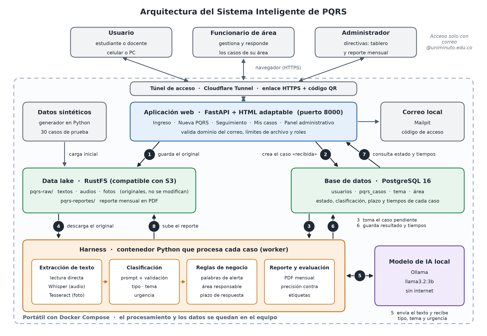
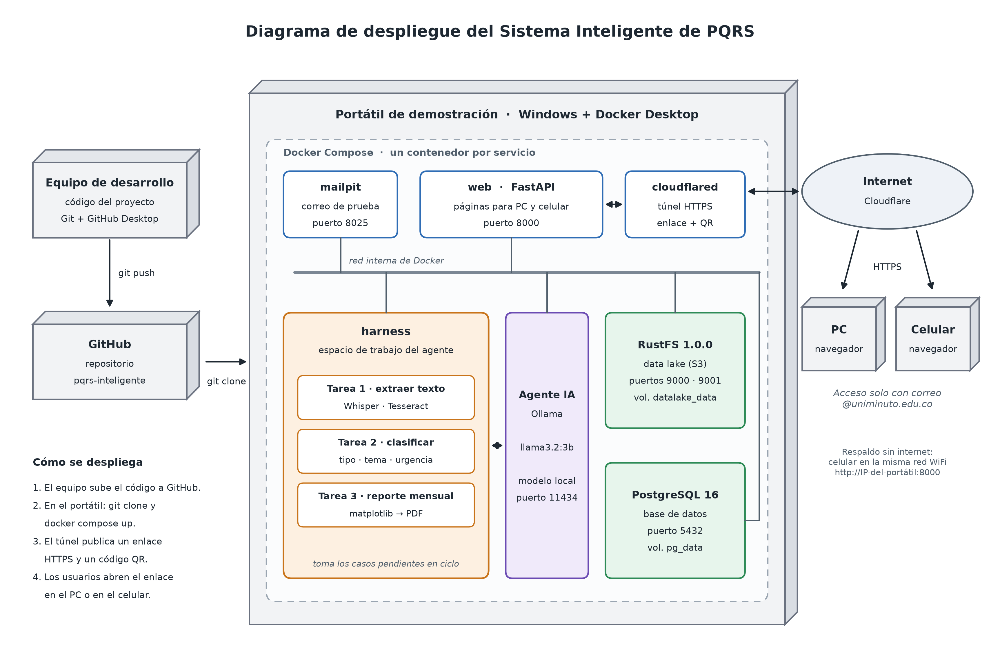

# PQRS Inteligente

Sistema para que estudiantes y docentes de UNIMINUTO radiquen **peticiones, quejas, reclamos y
sugerencias** por texto, audio o foto (juntos o por separado). Los originales se guardan en un
**data lake**, un **harness** extrae el texto (Whisper para audio, Tesseract para fotos) y un
**modelo de IA local** (Ollama, Llama 3.2 3B) clasifica cada caso por tipo, tema y urgencia y lo
envía al área responsable. Todo corre en un solo equipo con Docker, sin servicios de pago.



| Componente | Tecnología |
|---|---|
| Aplicación web y panel | FastAPI + HTML adaptable a celular (`web/`) |
| Data lake | RustFS 1.0.0, compatible con S3 (buckets `pqrs-raw` y `pqrs-reportes`) |
| Base de datos | PostgreSQL 16 (`db/init.sql`) |
| Harness | Contenedor Python: extracción, clasificación, reporte y evaluación (`harness/`) |
| IA local | Ollama con `llama3.2:3b` |
| Datos sintéticos | 30 casos con su clasificación correcta (`synthetic_data/`) |
| Acceso externo | Túnel HTTPS de Cloudflare con código QR |

## Requisitos

- **Docker Desktop** (en Windows, con WSL 2 activado). Es lo único que hay que instalar.
- **RAM:** 8 GB como mínimo; 16 GB recomendado. Cierra programas pesados antes de arrancar.
- **Disco:** unos 15 GB libres (imágenes, modelo de IA, Whisper y datos).
- **Internet:** solo la primera vez, para descargar unos 5 GB. Después funciona sin conexión
  (salvo el túnel para entrar desde otros dispositivos).

## Puesta en marcha

1. Clona el repositorio y entra a la carpeta:
   ```
   git clone https://github.com/vickys14/pqrs-inteligente.git
   cd pqrs-inteligente
   ```
2. Crea tu `.env` a partir del ejemplo y cambia las contraseñas:
   ```
   copy .env.example .env        (Windows)
   cp .env.example .env          (Mac / Linux)
   ```
   Pon tu correo institucional en `CORREOS_ADMIN` para entrar como administrador, y un texto
   largo cualquiera en `SECRET_KEY` (si queda vacío, las sesiones se cierran cada vez que se
   reinicia la web).
3. Levanta todo:
   ```
   docker compose -f docker-compose.yml -f docker-compose.web.yml up -d --build
   ```
   La primera vez tarda (descargas y construcción). Para ver cuándo termina de bajar el modelo:
   ```
   docker compose -f docker-compose.yml -f docker-compose.web.yml logs -f ollama-init
   ```
   Cuando diga `success`, sal con Ctrl + C.

| Qué | Dónde |
|---|---|
| Aplicación | http://localhost:8000 |
| Enlace público y QR para el celular | http://localhost:8000/acceso |
| Buzón de prueba con los códigos de acceso | http://localhost:8025 |
| Consola del data lake | http://localhost:9001/rustfs/console/ |

## Cómo se usa

1. Entra con un correo `@uniminuto.edu.co`. El código de acceso llega al buzón de prueba
   (o al correo real, si configuras `SMTP_*` en el `.env`).
2. En **Nueva PQRS** escribe, adjunta una foto con `+` o graba un audio con el micrófono, y radica.
3. El seguimiento se actualiza solo: el servicio `worker` (el harness en ciclo) extrae el texto,
   clasifica y muestra tipo, tema, urgencia, área, plazo de respuesta y tiempos de cada etapa.
4. Los funcionarios y administradores usan el **Panel**: bandeja por área, corregir la
   clasificación, responder al usuario, tablero, reportes y roles.

La primera clasificación tarda más (Ollama carga el modelo en memoria). Antes de una demostración,
radica una PQRS de prueba.

## Datos sintéticos, evaluación y reporte

```
# 1) Generar y subir los 30 casos de prueba (necesita internet para las voces)
cd synthetic_data
python -m venv .venv && .venv\Scripts\activate && pip install -r requirements.txt
python generar_datos.py
cd ..

# 2) El worker los clasifica solo. Para medir la precisión contra etiquetas.csv:
docker compose -f docker-compose.yml -f docker-compose.web.yml run --rm harness python evaluar.py

# 3) Reporte mensual en PDF (queda en reports/ y en el bucket pqrs-reportes)
docker compose -f docker-compose.yml -f docker-compose.web.yml run --rm harness python reporte.py --mes 2026-10
```

Resultados de referencia (30 casos, `ollama+reglas`): tipo 86,7 %, tema 86,7 %, urgencia 73,3 %,
urgencias altas detectadas 87,5 % (`reports/evaluacion_ollama+reglas.json`). En otro equipo
puede variar un caso por la versión de Ollama (`ollama/ollama:latest`); ver
`reports/evaluacion_ollama+reglas_pc-andres.json`.

## Despliegue y acceso desde el celular



El sistema corre en un portátil. El contenedor `tunnel` (cloudflared) publica un enlace HTTPS
temporal; en http://localhost:8000/acceso aparece el enlace y su código QR para abrirlo desde
cualquier celular o PC. El enlace cambia cada vez que se reinicia el túnel. Grabar audio desde el
navegador solo funciona por HTTPS (el túnel) o en `localhost`.

**Dirección fija con GitHub Pages.** Para no repartir un enlace nuevo cada vez, la página
`acceso/index.html` se publica en la rama `gh-pages` y redirige al enlace vigente del túnel:

```
python scripts/publicar_enlace.py
```

El script lee el enlace de la web local (`/api/enlace`), lo guarda en `enlace.json` de la rama
`gh-pages` y lo sube. Hay que ejecutarlo cada vez que se reinicie el túnel, con permiso de escritura
en el repositorio. Una sola vez hay que activar GitHub Pages en *Settings → Pages → Deploy from a
branch → gh-pages / (root)*. La dirección queda `https://<usuario>.github.io/pqrs-inteligente/`.

Respaldo sin internet: celular en la misma red WiFi abriendo `http://IP-del-portátil:8000`
(sin micrófono; el botón abre el selector de archivos de audio).

## Estructura

```
pqrs-inteligente/
├── docker-compose.yml       data lake, base de datos, Ollama y harness
├── docker-compose.web.yml   web, worker, correo de prueba y túnel
├── .env.example             variables (copiar a .env)
├── db/init.sql              esquema de la base
├── harness/                 extracción, clasificación, reporte y evaluación
├── web/                     aplicación web y panel (ver web/README.md)
├── synthetic_data/          generador de casos y etiquetas.csv
├── reports/                 evaluaciones y reportes generados
└── docs/                    diagramas de arquitectura y despliegue
```

## Problemas comunes

- **Docker Desktop muestra "An unexpected error occurred ... rename ... .sock"** (Windows): quedó
  un archivo de un cierre forzado. Cierra Docker, ejecuta `wsl --shutdown`, renombra la carpeta
  `%LOCALAPPDATA%\Docker\run` (y `%LOCALAPPDATA%\docker-secrets-engine` si también aparece) y abre
  Docker una sola vez. No uses "Reset to factory defaults": borra los datos. Para evitarlo, cierra
  Docker desde su ícono (*Quit Docker Desktop*) antes de apagar el PC.
- **`ERROR_TIMEOUT` al arrancar Docker:** falta memoria. Cierra programas pesados e inténtalo de nuevo.
- **Un puerto está ocupado (8000, 5432, 9000, 9001, 8025, 11434):** otro programa lo usa; ciérralo
  o cambia el puerto en el `docker-compose`.
- **No llega el código de acceso:** revisa el buzón de prueba en http://localhost:8025.
- **El micrófono no graba:** entra por el enlace HTTPS del túnel, no por la IP.
