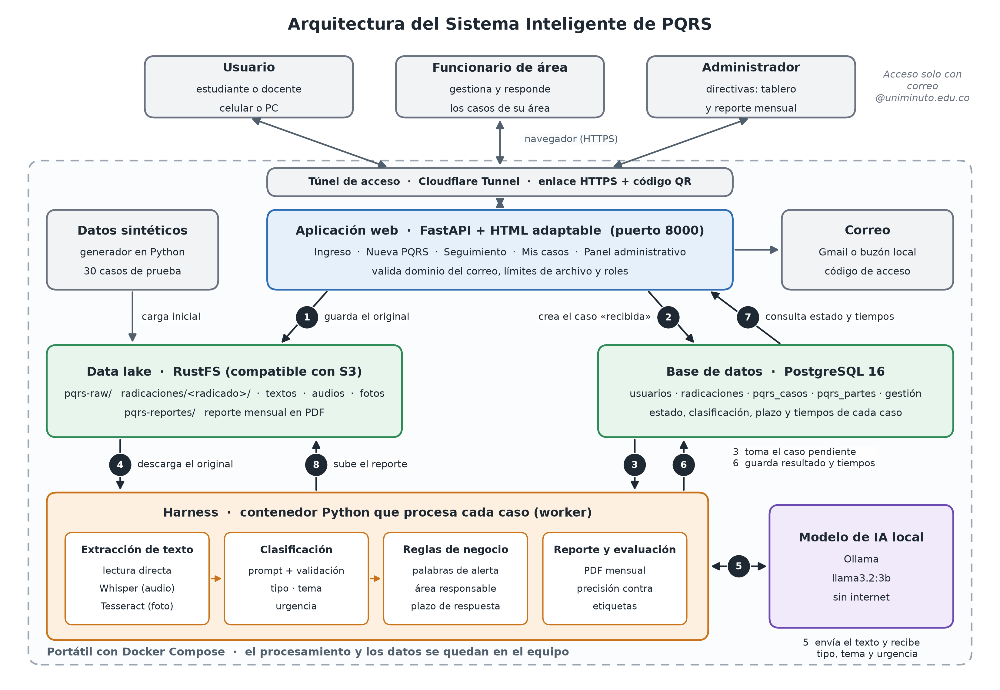
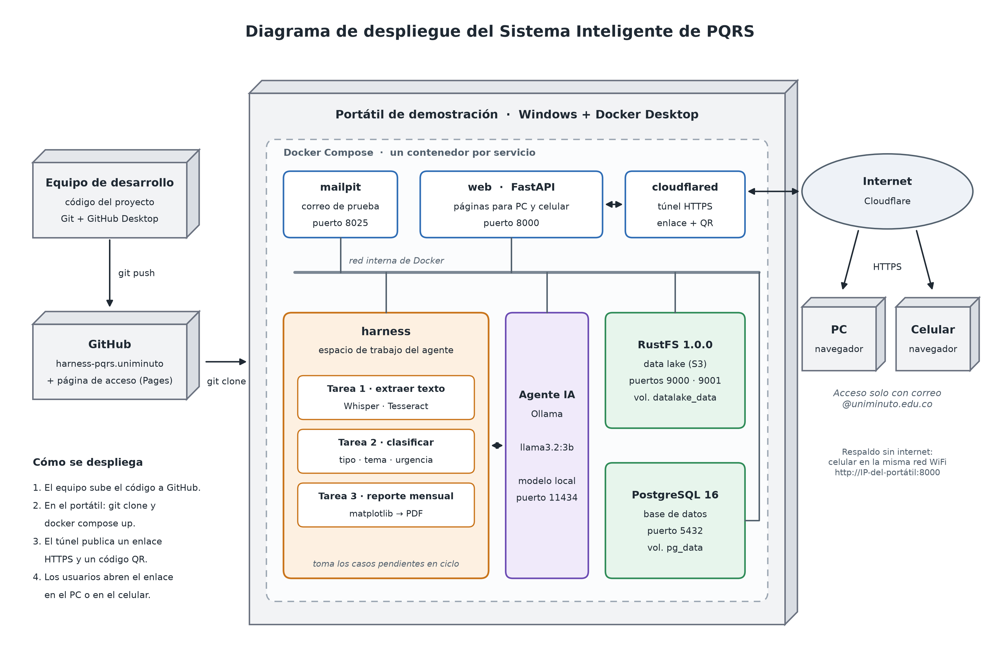

# Sistema Inteligente de PQRS — Arquitectura y reglas de negocio

Repositorio: https://github.com/andres82828828/harness-pqrs.uniminuto
Acceso fijo: https://andres82828828.github.io/harness-pqrs.uniminuto/

## 1. Diagrama de arquitectura

*Figura 1. Arquitectura del sistema. Todos los componentes corren en contenedores de Docker Compose en un mismo equipo. El procesamiento y los datos se quedan en ese equipo; el túnel solo da acceso desde otros dispositivos.*

## 2. Componentes

| Capa | Componente | Tecnología | Función |
|---|---|---|---|
| Presentación | Aplicación web | FastAPI + HTML adaptable (puerto 8000) | Pantallas para celular y PC: ingreso, nueva PQRS (texto, foto y audio en una sola caja), seguimiento, mis casos y panel. Valida el correo, los límites de archivo y los roles. |
| Acceso | Túnel | Cloudflare Tunnel | Publica un enlace HTTPS temporal y su código QR para abrir la aplicación desde cualquier celular o PC. Requiere internet. Respaldo: IP del portátil en la misma red WiFi. |
| Acceso | Página fija | GitHub Pages | Dirección que no cambia; redirige al enlace vigente del túnel (`scripts/publicar_enlace.py`). |
| Apoyo | Correo | Gmail (opcional) + Mailpit | Envía el código de acceso y las respuestas. Si el correo real no está configurado o falla, el mensaje queda en el buzón local y la página lo avisa. |
| Datos | Data lake | RustFS 1.0.0 (compatible con S3) | Guarda los originales tal como llegan y los reportes: `pqrs-raw/radicaciones/<radicado>/` (PQRS de la web), `pqrs-raw/textos|audios|fotos/` (datos sintéticos) y `pqrs-reportes/`. |
| Datos | Base de datos | PostgreSQL 16 | `usuarios`, `radicaciones`, `pqrs_casos` (resultado del modelo), `pqrs_partes` (texto y tiempo de cada parte), `gestion` (correcciones, estado y respuesta) e `historial`. |
| Procesamiento | Harness (worker) | Contenedor Python 3.11 | Revisa el data lake cada 3 s, extrae el texto de cada parte, clasifica, aplica las reglas y guarda el resultado. También genera el reporte mensual y la evaluación. |
| Procesamiento | Extracción de texto | faster-whisper `small` (audio), Tesseract en español (foto) | Convierte audios y fotos de formularios en texto. |
| Inteligencia artificial | Modelo local | Ollama 0.40.16 con `llama3.2:3b` | Clasifica el texto en tipo, tema y urgencia. La versión está fija para que los resultados sean reproducibles. |
| Apoyo | Datos sintéticos | Python (Pillow, gTTS) | 30 casos de prueba (10 textos, 10 audios, 10 fotos) y sus etiquetas correctas. |

## 3. Flujo de un caso (números del diagrama)

1. El usuario radica la PQRS en la web: texto, una foto y/o un audio. Cada parte se guarda en `pqrs-raw/radicaciones/<radicado>/` y al final se escribe `manifiesto.json`, que indica que el paquete está completo.
2. La web registra la radicación en la base de datos (tabla `radicaciones`) y entrega el número de radicado.
3. El harness encuentra el manifiesto nuevo.
4. El harness descarga cada parte y extrae su texto: lectura directa, Whisper o Tesseract. Mide cuánto tarda cada una.
5. Une los textos con etiquetas (primero lo escrito, luego el audio, al final la foto), los envía al modelo local y recibe tipo, tema y urgencia. Clasifica una sola vez por PQRS.
6. Aplica las reglas de negocio (palabras de alerta y área responsable) y guarda el caso en `pqrs_casos` y cada parte en `pqrs_partes`.
7. La pantalla de seguimiento se actualiza sola y muestra la clasificación, el plazo y los tiempos de cada etapa.
8. Cada mes, el harness genera el reporte en PDF y lo sube al data lake.

## 4. Roles

| Rol | Qué puede hacer |
|---|---|
| Usuario (estudiante o docente) | Radicar PQRS y consultar sus propios casos. |
| Funcionario de área | Ver los casos de su área, abrir los originales, corregir la clasificación y responder. |
| Administrador (directivas) | Ver todos los casos, el tablero y los reportes, y asignar roles y áreas. |

## 5. Reglas de negocio

### Acceso
- **RN-01.** Solo ingresan correos del dominio `@uniminuto.edu.co`, con un código de 6 dígitos que vence en 10 minutos (máximo 5 intentos). La validación se hace en el servidor.
- **RN-02.** Existen tres roles: usuario, funcionario de área y administrador. Cada uno ve solo lo que le corresponde.
- **RN-03.** No se aceptan PQRS anónimas: todo caso queda ligado a un correo institucional.
- **RN-04.** Antes de radicar, el usuario acepta el tratamiento de sus datos personales (Ley 1581 de 2012).

### Radicación
- **RN-05.** Cada caso recibe un número de radicado único, con el formato `PQRS-AAAA-NNNNNN`.
- **RN-06.** Los originales se guardan en el data lake antes de procesarlos y nunca se modifican.
- **RN-07.** Una PQRS puede traer texto, una foto y un audio, juntos o por separado. Límites: texto de hasta 2.000 caracteres (mínimo 20 si va solo, sin adjuntos), audio de máximo 2 minutos y 10 MB, foto PNG o JPG de máximo 5 MB.
- **RN-08.** Cada usuario puede radicar máximo 5 PQRS al día, y no puede radicar dos veces el mismo contenido.

### Clasificación
- **RN-09.** Tipo, tema y urgencia solo toman valores de catálogos cerrados. Tipo: petición, queja, reclamo, sugerencia. Urgencia: alta, media, baja.
- **RN-10.** El área responsable la asigna el sistema a partir del tema, no el modelo de IA.
- **RN-11.** Si el texto contiene una palabra de alerta (acoso, amenaza, riesgo, entre otras), la urgencia sube a alta. Ninguna regla baja la urgencia.
- **RN-12.** Si ninguna parte deja texto legible, el caso pasa a «revisión manual». Si una parte falla y otras no, se clasifica con las que sí dejaron texto y el error queda anotado. *Pendiente:* cuando el modelo responde un valor fuera del catálogo, el harness hoy usa un valor por defecto y lo registra en el log; lo correcto según esta regla sería mandarlo a revisión manual.
- **RN-13.** Un funcionario puede corregir la clasificación. Se conserva la respuesta original del modelo (`pqrs_casos`) y la corrección queda aparte (`gestion`), para auditar y medir la precisión.

### Tiempos y estados
- **RN-14.** Estados del caso: en proceso → clasificada → en gestión → respondida → cerrada. Estado alterno: revisión manual. Solo se cierra un caso respondido, y la respuesta tiene mínimo 10 caracteres.
- **RN-15.** Plazo de respuesta según la urgencia: alta, 1 día hábil; media, 5 días hábiles; baja, 15 días hábiles (tope de la Ley 1755 de 2015). Cuenta de lunes a viernes; no descuenta festivos.
- **RN-16.** Semáforo por caso: verde en plazo, amarillo cuando queda menos del 25 % del plazo, rojo si venció.
- **RN-17.** El sistema registra y muestra cuánto tardó cada etapa: lectura del texto, transcripción del audio, OCR de la foto, clasificación con IA y total desde la radicación.

### Comunicación
- **RN-18.** La respuesta del funcionario le llega al usuario por correo y queda visible en «Mis casos».
- **RN-19.** Si el correo real falla, el código o la respuesta quedan en el buzón local de respaldo y la pantalla lo informa; nadie queda bloqueado sin su código.

### Privacidad
- **RN-20.** Los reportes para directivas no incluyen nombres ni correos.
- **RN-21.** Los casos se almacenan y clasifican en el equipo: el modelo de IA es local. El túnel solo transporta la conexión del navegador, cifrada con HTTPS.
- **RN-22.** Las contraseñas y claves viven solo en el archivo `.env`, que no se sube al repositorio.

## 6. Diagrama de despliegue

*Figura 2. Despliegue. El código vive en GitHub; un solo portátil con Docker Desktop ejecuta todos los contenedores; los usuarios entran desde el navegador del PC o del celular por un enlace HTTPS del túnel, al que también lleva la página fija de GitHub Pages.*

| Nodo | Qué corre ahí |
|---|---|
| Equipo de desarrollo | Código del proyecto; se sube a GitHub con `git push`. |
| GitHub | Repositorio `harness-pqrs.uniminuto` (rama `main`) y la página fija de acceso (rama `gh-pages`, publicada con GitHub Pages). |
| Portátil de demostración | Docker Compose con un contenedor por servicio: web, worker (harness), Ollama, RustFS, PostgreSQL, Mailpit y cloudflared, conectados por la red interna de Docker. |
| Internet (Cloudflare) | Solo transporta la conexión HTTPS del túnel hasta el portátil. |
| PC o celular del usuario | Navegador. No se instala nada: la misma página se adapta a la pantalla. |

El harness es el espacio de trabajo del agente: toma los casos pendientes y ejecuta tres tareas (extraer el texto, clasificar con el agente de IA y generar el reporte mensual). El agente es el modelo local `llama3.2:3b` en Ollama.

## 7. Resultados de la evaluación

Sobre los 30 casos sintéticos de un solo canal (`ollama+reglas`):

| Medida | Equipo de Victoria | Equipo de Andrés |
|---|---|---|
| Tipo | 86,7 % | 86,7 % |
| Tema | 86,7 % | 83,3 % |
| Urgencia | 73,3 % | 73,3 % |
| Urgencias altas detectadas | 87,5 % | 87,5 % |

El prompt es idéntico en ambos equipos; la diferencia de un caso (`caso_010`) viene de la versión de Ollama, que entonces no estaba fija. Por eso ahora se usa `ollama/ollama:0.40.16`. Las PQRS de varias partes funcionan, pero todavía no tienen un conjunto de prueba propio, así que no hay cifras de precisión para ellas.

## 8. Pendientes por confirmar con el profesor

- Los plazos de urgencia alta y media (RN-15) son una propuesta del equipo.
- Qué espera de los 13 pasos del OPC.
